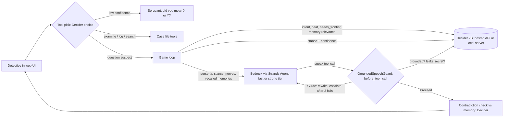

# Interrogation Room

A murder-mystery agent where AI suspects are driven by **Strands Decider 2B** decisions and voiced by
**Amazon Bedrock**. You are the detective; four suspects each have a cover story and a secret. Decider
picks what each suspect *does* (stance, nervousness, which memories matter, whether a reply is safe to
say); Bedrock writes what they *say*. Decider's calibrated confidence becomes the suspect's nervousness,
and every turn shows the full decision trace, including a live step log.

**Declared decision pattern: Guardrails** (`#guardrails`, with `#strands-decider-2b`).
The reusable pattern is the **Grounded Speech Guard** in [`guards.py`](guards.py): a Strands
`InterventionHandler` that asks Decider whether a proposed reply is grounded in the allowed facts and
whether it leaks a secret. Supporting decisions: stance selection (policy), model routing, tool selection
and memory relevance.

> Decider is experimental. Numbers in this repo are only ever printed by a script against a real server.

## Reusable decision pattern: Grounded Speech Guard (`guards.py`)

**What it does.** The agent speaks through a `speak(text)` tool. Before every call, a
`before_tool_call` intervention asks Decider two typed yes/no questions about the proposed text. If either
fails, the model gets the turn back with feedback (`Guide`) and rewrites; after two retries a safe line is
used so the agent never stalls (or the caller escalates to a stronger model via `guard.exhausted`).

**Typed questions** (`decisions.py`, both `noul`, asked together in one request):

| Question | Fails when |
|---|---|
| `GROUNDED`: is every factual claim found in the knowledge sheet or cover story? | P(true) < 0.45 |
| `LEAKS_SECRET`: does the statement admit or describe the specific event in the secret? | P(true) >= 0.65 |

The cutoffs are policy knobs owned by code, not by the model. They came from scoring 9 hand-written lines
against the hosted Decider (grounded lines scored 0.56-0.61 vs invented 0.24-0.37; safe lines 0.50-0.60 vs
leaking lines 0.68-0.83), so re-check them on your own data.

**Wiring.**

```python
guard = GroundedSpeechGuard(decider, facts="...allowed facts...", secret="...must stay hidden...")
agent = Agent(model=..., tools=[speak], interventions=[guard])
```

**Reuse it.** Pass the allowed facts (and optionally a secret) for any persona, bot or support agent and
give the agent a tool to speak through. Keep facts short: Decider reads a 4K-token window. `guard.trace`
records every verdict; `guard.notify` (optional) streams progress to a UI.

## Other decisions handed to Decider

| # | Question | Type | Drives |
|---|----------|------|--------|
| 0 | Which tool does the free-form action mean (and which target)? | choice | tool routing, "did you mean..." gate |
| 1 | What is the detective doing? | choice | pressure level |
| 2 | Is the line close to the secret? | noul | heat |
| 3 | Does the reply need a nuanced performance? | noul | Bedrock model tier (routing) |
| 4 | Is memory chunk N relevant to this line? (up to 8) | noul | what goes in the prompt |
| 5 | How should the suspect respond? | choice | stance; confidence feeds nervousness |
| 6 | Are all claims grounded in the sheet? | noul | guard |
| 7 | Does the statement leak the secret? | noul | guard |
| 8 | Does the new line contradict memory N? | noul | slips the player can catch |

Memory relevance and contradiction scoring (`memory.py`) is a second reusable recipe: one `noul` question
per memory chunk, batched into the request you already make each turn.

## Architecture



Per turn: about 5 to 10 Decider requests (the hosted tier allows 4 questions per request, so larger
batches are split by `decider_client.py`) plus 1 Bedrock generation (2 if the fast tier is escalated).
Follow-up questions and the Sergeant's options are built from the case file with no extra model calls.

## Run it

```bash
pip install -r requirements.txt
cp .env.example .env      # then fill in the values
python server.py          # http://localhost:8000
```

`.env` settings:

| Variable | Meaning |
|---|---|
| `DECIDER_MODE` | `ugmdu` (hosted API, needs `DECIDER_API_KEY`) or `local` |
| `DECIDER_URL`, `DECIDER_API_KEY` | endpoint and key; the hosted URL is in `.env.example` |
| `AWS_REGION`, `BEDROCK_MODEL_FAST`, `BEDROCK_MODEL_STRONG` | Bedrock region and the two model or inference-profile ids enabled in your account |

AWS credentials come from the usual places (`aws configure`, a profile, or an instance role).
To run Decider yourself instead: `pip install -r requirements-local.txt`,
`strands-decider serve StrandsAgents/strands-decider-2B-hobson-v19 --port 8099`, and set
`DECIDER_MODE=local`, `DECIDER_URL=http://localhost:8099`.

No keys or AWS account yet? `MOCK=1 python server.py` runs the whole UI with keyword heuristics standing in
for Decider and canned suspect lines. Mock mode is labelled in the UI and `bench.py` refuses to run in it.

Sharing a public demo: set `ACCESS_CODE` (and optionally the turn limits) in `.env`; see DEPLOY.md.
Deploying on AWS: see [DEPLOY.md](DEPLOY.md) (`deploy/ec2-userdata.sh`). Before publishing, run
`python secret_scan.py`.

## Status: verified vs not

**Verified (live, on a developer machine):** full turns against the hosted Decider API and Amazon Bedrock
(Claude Haiku and Sonnet tiers) through Strands Agents, including the guard approving and rejecting lines,
the live step log, follow-up questions, contradiction checks and the Sergeant's options (the options and
the billiard-room clue were exercised in mock mode only).

**Known limits:**
- A live turn takes roughly 25 to 30 seconds, mostly sequential Decider calls; the hosted free tier allows
  10 requests a minute, so quick play can hit the limit.
- Guard cutoffs were calibrated on 9 lines for one suspect; the guard can pass invented details that are close
  to the facts (it passed a tenure that was not on the sheet).
- Not yet run: the EC2 deployment and `bench.py` latency/routing benchmarks.

## Credits

Built for the AWS Agent Experience Hackathon. Hosted Decider access provided by **AWS User Group Madurai**.
Licensed under the Apache License 2.0 (see [LICENSE](LICENSE)).
